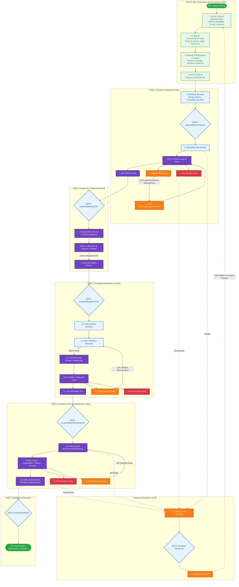

# Circuito de Procesos y Flujograma del Sistema FONAVIS (SIPP)

Este documento detalla el ciclo de vida completo de un proyecto habitacional en el **Portal FONAVIS (Sistema Integrado de Postulación de Proyectos - SIPP)**, especificando los actores intervinientes, las 22 etapas del flujo, el rol de **DGFO como PIVOT / eje central articulador**, las transiciones permitidas, las reglas de negocio y los mecanismos de control y auditoría.

---

## 1. Actores y Dependencias Intervinientes

| Dependencia / Actor | Código / ID | Tipo | Rol y Responsabilidad Principal |
| :--- | :---: | :--- | :--- |
| **SAT** *(Servicio de Asistencia Técnica)* | Externo | Usuario SAT | Presenta el proyecto, inscribe y actualiza postulantes/miembros, carga carpetas documentales y subsana observaciones técnicas, sociales y legales. |
| **DGFO** *(Dirección General del FONAVIS)* | `1` | **PIVOT Central** | **Eje coordinador y articulador central.** Recibe del SAT, deriva a las direcciones evaluadoras, re-enruta los dictámenes aprobados a la siguiente fase y canaliza las devoluciones. |
| **DGJN** *(Dirección General Jurídica y Notarial)* | `2` | Dirección Evaluadora | Revisión legal de títulos, terrenos, personerías, memorándums y cumplimiento normativo legal. |
| **DGSO** *(Dirección General Social)* | `3` | Dirección Evaluadora | Evaluación socioeconómica, verificación de ingresos familiares, cálculo de niveles de subsidio, calificación social y migración a SHD. |
| **DIGH** *(Dirección General del Hábitat)* | `4` | Dirección Evaluadora | Verificación técnico-ambiental in situ del terreno (VTA), servicios básicos y viabilidad del suelo. |
| **DSGO** *(Dirección de Subsidios a Grupos Organizados)* | `5` | Dirección Evaluadora | Evaluación técnico-habitacional, fiscalización de planos constructivos, cómputo métrico, presupuesto y tipologías habitacionales. |
| **MESA DE ENTRADA** | `6` | Administrativo | Recepción física y protocolización de expedientes iniciales. |
| **DGTI** *(Dirección General de Tecnologías de la Información)* | `7` | Super Admin | Soporte técnico integral; tiene facultades para transicionar proyectos a cualquier etapa para resolución de incidentes. |

---

## 2. El Rol Articulador de DGFO como PIVOT Central

> [!IMPORTANT]
> **Principio de Funcionamiento:**  
> Las Direcciones Evaluadoras (DGJN, DGSO, DIGH, DSGO) y el SAT **no interactúan de forma directa y desordenada entre sí**.  
> **La DGFO actúa como el PIVOT y canalizador formal** que recibe los dictámenes aprobados de cada fase y abre la compuerta hacia la siguiente dirección, garantizando el orden secuencial del expediente.

---

## 3. Matriz de Pivotaje: ¿Cómo y Hacia Dónde Deriva DGFO?

A continuación se detalla cada salto interinstitucional donde **DGFO actúa como pivot**:

| Fase | De Dónde Proviene (Origen) | Estado Previo | Acción / Intervención de DGFO (El Pivot) | Vista Especial en DGFO | Estado Resultante | Hacia Dónde Va (Destino / Siguiente Dirección) |
| :---: | :--- | :---: | :--- | :--- | :---: | :--- |
| **Pivot 1** | **SAT** *(Ingreso nuevo)* | `1. ENVIADO` | Recibe el proyecto, verifica documentos de mesa de entrada y transiciona formalmente. | `showVERDOCFONAVIS` | `2. REVISIÓN PRELIMINAR` | **DGJN** *(Dirección General Jurídica y Notarial)* para dictamen legal. |
| **Pivot 2** | **DGJN** *(Dictamen legal favorable)* | `3. APROBADO DGJN` | Constata aprobación legal, abre la etapa social y deriva el listado de familias a evaluar. | `showFONAVISSOCIAL` | `7. EVALUACIÓN SOCIAL` o `8. GRUPO FAMILIAR ENVIADO` | **DGSO** *(Dirección General Social)* para calificación familiar. |
| **Pivot 3** | **DGSO** *(Dictamen social finalizado)* | `9. CON DICTAMEN SOCIAL` | Recibe el dictamen social y la migración SHD, habilita la etapa técnica y deriva el legajo ambiental. | `showFONAVISTECNICO` | `10. EVALUACIÓN TÉCNICA` $\rightarrow$ `11. DOC. TÉCNICA ENVIADA` $\rightarrow$ `12. VERIF. TÉCNICO AMBIENTAL` | **DIGH** *(Dirección General del Hábitat)* para inspección in situ del predio. |
| **Pivot 4** | **DIGH** *(Aprobación ambiental)* | `13. CON INFORME VTA` | Recibe informe VTA favorable del terreno y canaliza el proyecto a fiscalización constructiva. | `showFONAVISTECNICODOS` | `16. EVALUACIÓN TÉCNICO HABITACIONAL` | **DSGO** *(Dirección de Subsidios a Grupos Organizados)* para revisión de planos y tipología. |
| **Pivot 5** | **DSGO** *(Aprobación técnica de obras)* | `19. CON CALIFICACIÓN TÉCNICA HABITACIONAL` | Consolida dictámenes (Jurídico, Social, Ambiental y Técnico) y eleva para resolución ministerial. | `showFONAVISADJ` | `20. ADJUDICADO` | **Máxima Autoridad / FONAVIS** *(Firma de resolución y entrega de subsidios)*. |
| **Pivot Devolución** | **Cualquier Dirección** *(Jurídica, Social o Técnica)* | `21. DEVOLUCIÓN FONAVIS` | Evalúa la no procedencia interna y formaliza la salida del proyecto hacia el SAT fuera del circuito activo. | Bandeja General `showFONAVIS` | `22. DEVOLUCIÓN SAT` | **SAT** para rehacer o corregir integralmente y reiniciar en `1. ENVIADO`. |

---

## 4. Matriz Completa de las 22 Etapas del Sistema

| ID | Nombre de Etapa | Quién Actúa | Condición Previa | Siguientes Estados Posibles | Rol en el Circuito y Acciones |
| :-: | :--- | :--- | :--- | :--- | :--- |
| **1** | **ENVIADO** | SAT | Proyecto cargado por SAT. | `2` *(primera vez)* `12, 16, 22` *(reenvío)* | El SAT envía el proyecto. El formulario de datos queda congelado para el SAT y entra a la bandeja de DGFO. |
| **2** | **REVISIÓN PRELIMINAR** | DGFO / Mesa | Estado 1 o reingresos. | `3, 4, 6, 21` | **DGFO (Pivot 1):** Revisa legajos preliminares y remite a DGJN. |
| **3** | **APROBADO DGJN** | DGJN | Estado 2, 5 o 6. | `2, 7, 8` | **DGJN:** Emite dictamen legal favorable del terreno y personería. Habilita a DGFO para pivotar a DGSO. |
| **4** | **OBSERVADO DGJN** | DGJN | Estado 2 o 5. | `3, 5, 21` | **DGJN:** Notifica faltantes legales al SAT. *(Regla: DGFO tiene bloqueado este estado; no puede actuar hasta que el SAT subsane o DGJN resuelva).* |
| **5** | **CON DOCUMENTACIÓN DGJN** | SAT | Estado 4. | `3, 4, 6` | **SAT:** Sube documentos/memorándums para responder las observaciones legales directamente ante DGJN. |
| **6** | **RECHAZADO DGJN** | DGJN | Estado 2 o 5. | `3, 4` | **DGJN:** Rechazo por incompatibilidad legal o incumplimiento grave de requisitos de terreno o SAT. |
| **7** | **EVALUACIÓN SOCIAL** | DGSO | Estado 3 (vía Pivot DGFO). | `8, 9` | **DGSO:** Revisa ingresos, titular, cónyuge, otros ingresos, tercera edad, discapacidad y niveles 1 a 4. |
| **8** | **GRUPO FAMILIAR ENVIADO** | DGSO / SAT | Estado 3 o 7. | `2, 9` | **DGSO:** Nómina de familias confirmada para calificar. |
| **9** | **CON DICTAMEN SOCIAL** | DGSO | Estado 7 u 8. | `10` | **DGSO:** Cierra calificación (`calificacion_finalizada = true`), sincroniza a SHD y remite a DGFO. |
| **10** | **EVALUACIÓN TÉCNICA** | DGFO | Estado 9. | `11` | **DGFO (Pivot 3):** Toma el dictamen social y da apertura formal a la fase técnica. |
| **11** | **DOCUMENTACIÓN TÉCNICA ENVIADA** | DIGH / DSGO / DGFO | Estado 10. | `12` *(DGFO)* `19` *(DSGO)* `13` *(DIGH)* | Remisión de legajos técnicos. **DGFO** transiciona este estado a 12 para remitir a DIGH. |
| **12** | **VERIFICACIÓN TÉCNICO AMBIENTAL** | DIGH | Estado 11 (vía Pivot DGFO). | `13, 14, 15` | **DIGH (Hábitat):** Inspección ambiental in situ, inundabilidad, suelo y servicios básicos. |
| **13** | **CON INFORME VTA** | DIGH | Estado 11 o 12. | `16` | **DIGH (Hábitat):** Aprueba informe VTA favorable. Habilita a DGFO a pivotar a DSGO. |
| **14** | **OBSERVACIÓN DIGH** | DIGH | Estado 12. | `11, 13, 15` | **DIGH (Hábitat):** Requerimientos de adecuación técnica o ambiental del predio hacia el SAT. |
| **15** | **RECHAZADO DIGH** | DIGH | Estado 12. | `11, 13` | **DIGH (Hábitat):** Inviabilidad ambiental o del terreno. |
| **16** | **EVALUACIÓN TÉCNICO HABITACIONAL** | DSGO | Estado 13 (vía Pivot DGFO). | `17, 18, 19, 21` | **DSGO (Grupos Organizados):** Fiscalización de planos constructivos, tipología, cómputos y presupuesto. |
| **17** | **OBSERVACIÓN DSGO** | DSGO | Estado 16. | `16, 18, 19` | **DSGO (Grupos Organizados):** Objeciones a planos o memorándums de cómputo hacia el SAT. |
| **18** | **RECHAZADO DSGO** | DSGO | Estado 16 o 17. | `16, 19` | **DSGO (Grupos Organizados):** Rechazo técnico de obras. |
| **19** | **CON CALIFICACIÓN TÉCNICA HABITACIONAL** | DSGO | Estado 11 o 16. | `20, 21` | **DSGO (Grupos Organizados):** Aprobación técnica final de obras. Habilita a DGFO a elevar a Adjudicación. |
| **20** | **ADJUDICADO** | Máxima Autoridad / DGFO | Estado 19 (vía Pivot DGFO). | *(Fin de ciclo)* | **DGFO / Ministro:** Firma de resolución y concesión de subsidios habitacionales para el proyecto. |
| **21** | **DEVOLUCIÓN FONAVIS** | Direcciones / DGFO | Estado 2, 4, 16 o 19. | `22` | **Direcciones:** Envían a DGFO el proyecto no procedente para trámite de devolución. |
| **22** | **DEVOLUCIÓN SAT** | DGFO | Estado 21. | `1` | **DGFO (Pivot Devolución):** Formaliza la devolución al SAT para corregir fuera del circuito activo. |

---

## 5. Reglas Críticas de Negocio y Seguridad

### A. Restricciones de Acción por Dependencia
* **DGFO vs. Estado 4 (OBSERVADO DGJN):**
  * La DGFO tiene restringido expresamente actuar o alterar el estado `4`. Únicamente la Dirección Jurídica (DGJN) o la subsanación del SAT pueden modificar este estado.
* **DGSO (Cierre de Calificación y Migración):**
  * Una vez que la calificación es marcada como `calificacion_finalizada = true`, la vista se congela en modo lectura para evitar adulteraciones posteriores a la firma del dictamen. Solo usuarios autorizados de DGSO pueden solicitar re-habilitación.
* **DGTI (Super Admin Técnico):**
  * La Dirección de Informática tiene habilitadas todas las etapas en cualquier momento para rescate o resolución de contingencias técnicas.

### B. Transiciones Seguras (Anti-Retrocesos Ilegítimos)
* Un proyecto con más de un estado registrado **no puede ser devuelto a Pendiente de forma directa** (`transitionEliminar`); debe canalizarse obligatoriamente por el circuito de **`DEVOLUCIÓN FONAVIS (21)` $\rightarrow$ `DEVOLUCIÓN SAT (22)`**.

### C. Auditoría y Trazabilidad Total
* Todo cambio de estado, modificación de campos en proyectos o postulantes, alta de cónyuges, cargas de archivos o eliminaciones registra automáticamente:
  1. **Usuario ejecutor** (ID y correo).
  2. **Tipo de evento** (`created`, `updated`, `deleted`).
  3. **Valores anteriores (`old_values`) y nuevos (`new_values`)**.
  4. **Fecha, hora exacta e IP**.
  5. Consulta accesible en el módulo de [Auditoría de Administradores](file:///c:/Users/osemidei/Documents/portal_fonavis/resources/views/admin/audit/show.blade.php).
